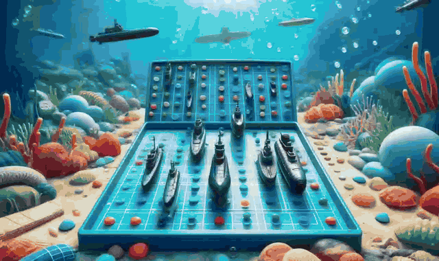
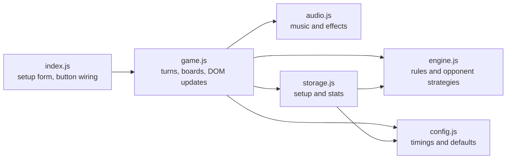
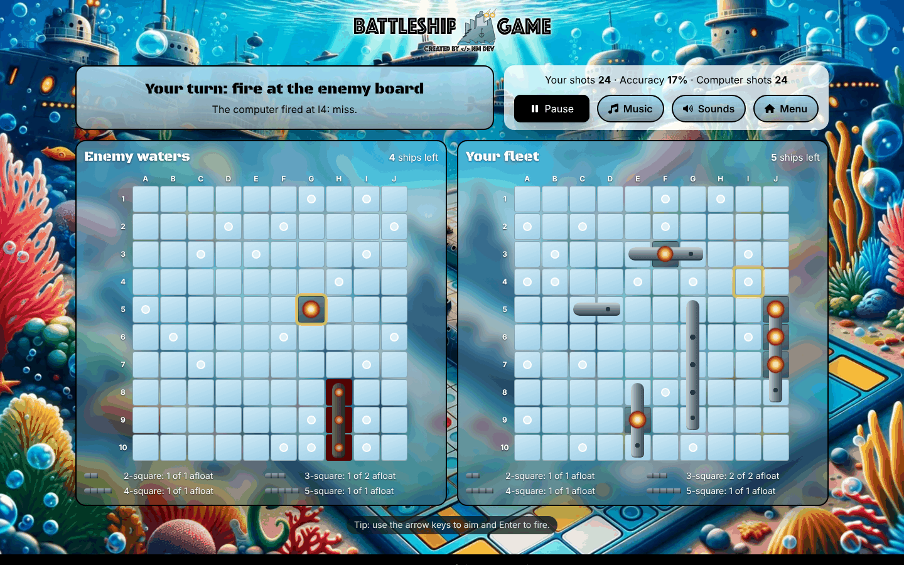
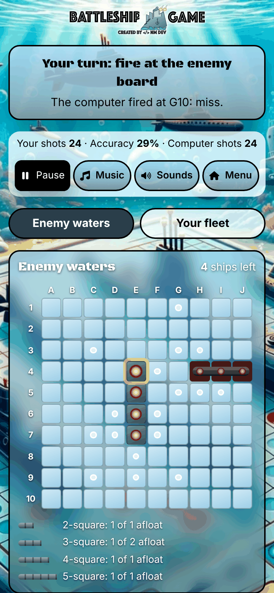
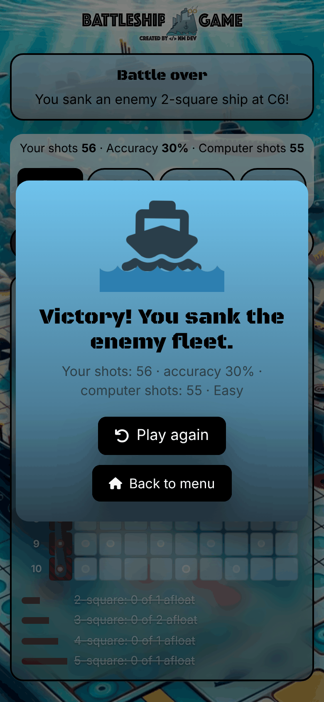
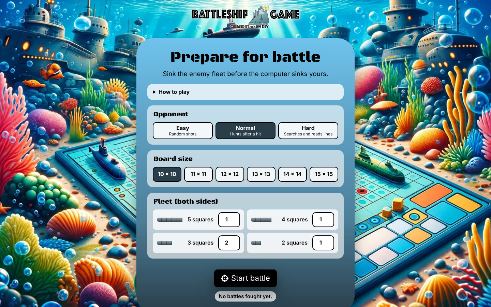
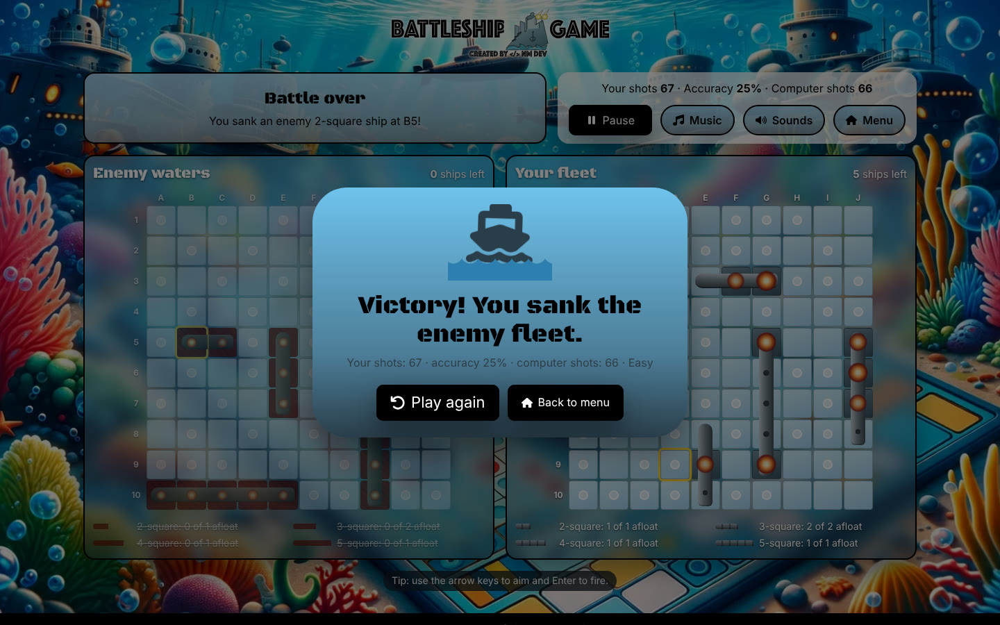
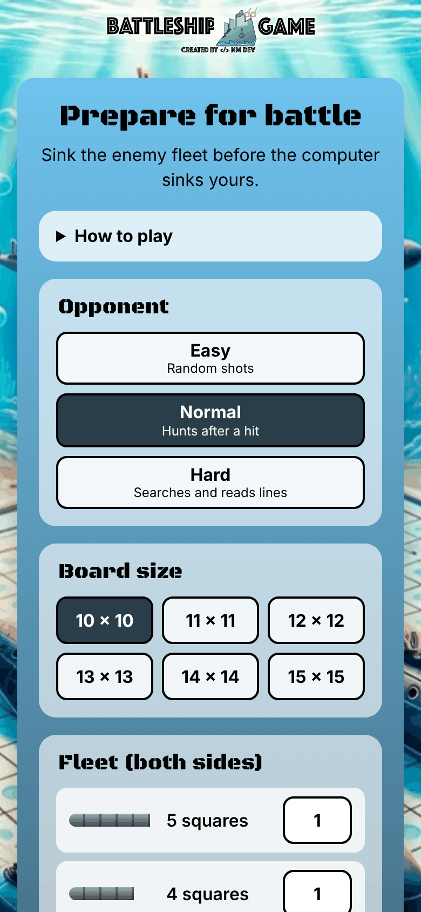
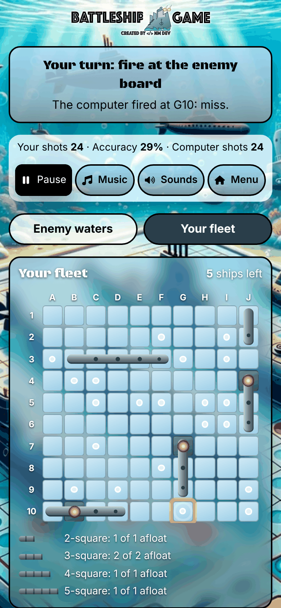

<a id="top"></a>

<div align="center">

  

  <h1>⚓ Battleship Game</h1>

  <h3>Classic Battleship against a computer opponent with three strategies, built with vanilla JavaScript.</h3>

  <p>
    <a href="https://nitzanm23.github.io/battleship-game/">
      
    </a>
  </p>

  <p>
    
    
    
    
    <a href="https://github.com/nitzanm23/battleship-game/actions/workflows/ci.yml">
      
    </a>
  </p>

</div>

<p align="center">
  
</p>

---

## 🎯 Overview

**Battleship Game** is the classic naval strategy game, played in the browser against the computer. You choose the opponent's strategy, the board size, and the fleet, then take turns firing until one fleet is sunk.

It has no framework and no build step. The rules and the computer's strategies live in a pure JavaScript module with no DOM, which lets a suite of 65 automated tests check fleet placement, every opponent level, and complete scripted battles in Node.

> **Scope:** A single-player game that runs entirely in the browser. There are no accounts or online play; your last setup and your win/loss record are saved on your own device.

---

## 🎲 How to Play

1. Choose an opponent, a board size (10 × 10 up to 15 × 15), and how many ships of each length both sides get. The default is the classic fleet: 5, 4, 3, 3, and 2 squares.
2. Both fleets are placed at random. Ships are straight and never touch, not even at the corners.
3. You fire first. Each side fires one shot per turn, even after a hit.
4. Your own fleet and the computer's shots are on the second board. On a phone, switch between the two boards.
5. Firing at a square twice does not cost your turn. The first side to sink every enemy ship wins.

---

## ✨ Features

- **Three opponent strategies:** Easy fires at random, Normal hunts around its hits, and Hard searches in a checkerboard pattern and reads the direction of a ship.
- **Custom battles:** Six board sizes and any fleet that fits. If a fleet cannot fit with a gap between ships, the game says so before the battle starts.
- **Animated battle:** Misses throw up a splash and a ripple, hits explode and keep burning, and a sunk ship appears as a burnt hull that flashes square by square while the board shakes. Your own fleet is drawn as whole ships, not loose squares.
- **Clear feedback:** A red reticle shows where you are aiming, the latest shot on each board is ringed, and fleet lists show which ships are still afloat.
- **Saved progress:** Your last setup, music and sound choices, wins, losses, and fewest shots to win are kept between visits.
- **Keyboard play:** Arrow keys aim across the enemy board, Home and End jump to the corners, and Enter fires.
- **Pause and fair play:** Pause stops the computer mid-aim and resumes with the time it had left. Switching tabs pauses the battle automatically.
- **Animated results:** A ship rides the waves for a victory and sinks for a defeat, drawn in CSS instead of GIFs.

---

## 🧠 Technical Highlights

- **Opponent strategies that measurably differ:** Over 40 random fleets on a 10 × 10 board, Easy needs about 94 shots to win, Normal about 62, and Hard about 44. A test replays those battles and fails if a higher level is not stronger.
- **Fair by design:** The opponent receives only the results of its own shots (miss, hit, sunk), never the player's fleet, so it cannot cheat.
- **Fleet placement with a safety limit:** Ships are placed by randomized backtracking, longest first, with a cap on attempts. An impossible fleet fails in milliseconds with a clear message instead of freezing the page, and a partial fleet is never returned.
- **Turn timing that survives pauses:** The computer's delayed shot records how much time it had left when paused and continues from there. Every battle has a generation number, so a shot scheduled for an earlier battle can never land in a new one.
- **Boards that fit any screen:** Square size is calculated from the panel's own width with container query units (`cqi`), between a 26px tap target and a 42px mouse target. A 15 × 15 board on a small phone scrolls inside its panel instead of widening the page.
- **Accessible boards:** Real tables with lettered columns and numbered rows. Every square is labeled with its coordinate and state (for example "C2, hit"), only one square is in the tab order (roving `tabindex`), and the result is a native `<dialog>`.
- **Ships drawn without images:** Each square of a ship knows whether it is the bow, the middle, or the stern and which way the ship lies, and CSS joins the squares into one hull across the gaps. Enemy ships get this only once sunk, so the page never reveals a hidden ship.
- **Original, balanced sound effects:** Splashes, hits, and explosions are synthesized by a small Python script in `tools/`, so the game ships no third-party samples. Every effect is scaled to the same loudness, and low rumbles are soft-clipped so phone and laptop speakers can still play them. After you sink a ship, the computer waits longer, so the explosion is heard before its next shot.

---

## 🏗️ Architecture



| Module       | Responsibility                                                               | Touches the DOM |
| ------------ | ---------------------------------------------------------------------------- | :-------------: |
| `engine.js`  | Setup validation, fleet placement, shots, sinking, the three opponent levels |       No        |
| `config.js`  | Timings, limits, default fleet, and the opponent levels' labels              |       No        |
| `storage.js` | Loading, validating, and saving the last setup and statistics                |       No        |
| `audio.js`   | Background music and sound effects, created only when first needed           |       No        |
| `game.js`    | One battle at a time: turns, the computer's delayed shot, boards, result     |       Yes       |
| `index.js`   | Fills the setup form, connects the form and buttons to `game.js`             |       Yes       |

---

## 🧪 Testing

The project has **65 tests** written with Node's built-in test runner, so there is nothing to install:

```bash
npm test
```

| File                    | What it checks                                                                                                              |
| ----------------------- | --------------------------------------------------------------------------------------------------------------------------- |
| `tests/engine.test.js`  | Setup validation, fleet placement on every board size, shots and sinking, coordinates, and each opponent level              |
| `tests/flow.test.js`    | Scripted battles in a simulated browser: turns, wins, losses, sinking, pause, tab switching, keyboard aiming, labels, audio |
| `tests/storage.test.js` | Defaults, saving and reloading, best win, corrupted and tampered data, storage that throws                                  |
| `tests/audio.test.js`   | Lazy loading, music rules, effect replay, blocked playback                                                                  |
| `tests/startup.test.js` | Filling the form from saved data, submitting it, board switching, Escape on the result dialog                               |
| `tests/assets.test.js`  | Unique ids, ARIA references, every file, sound, and icon the code uses, README links                                        |

The flow tests run the real `game.js` against a small fake DOM, a controllable clock, and a fake `Audio` (`tests/helpers/fake-dom.js`), so a full battle plays out in milliseconds. They check behavior, not layout; the layout was checked in Chrome from 360px to 1440px, with axe-core and Lighthouse.

---

## 🧰 Tech Stack

- **HTML5 & CSS3:** custom properties, BEM, Grid, container queries, native `<dialog>`, `inert`
- **Vanilla JavaScript (ES modules):** no framework, no bundler
- **Node.js 22 `node:test`:** unit and behavior tests, no dependencies
- **Python + NumPy + ffmpeg:** sound effect generator (`tools/make-sfx.py`, not needed to play)
- **Black Ops One:** self-hosted display font in `vendor/fonts/`
- **Font Awesome Free 6.7.2:** 10 icons in one SVG sprite (`assets/icons/icons.svg`)
- **GitHub Actions:** tests, HTML validation, Lighthouse CI, and GitHub Pages deployment

---

## 📁 Project Structure

```text
battleship-game/
├── index.html
├── manifest.webmanifest  # home screen name, colors, and icons (install as an app)
├── package.json          # "npm test" script and Node version; no dependencies
├── assets/
│   ├── audio/            # background music and six original sound effects
│   ├── icons/            # favicon, home screen icons, icon sprite
│   ├── images/           # opening and game backgrounds, social preview image
│   └── logos/
├── styles/
│   ├── tokens.css        # design tokens (colors, board colors, spacing, motion)
│   ├── reset.css         # browser defaults, focus ring, reduced motion
│   ├── page-loader.css   # opening screen and backgrounds
│   └── index.css         # layout and components
├── scripts/
│   ├── engine.js         # rules, fleet placement, opponent strategies (pure functions)
│   ├── config.js         # timings, limits, and defaults
│   ├── storage.js        # saved setup and statistics
│   ├── audio.js          # music and sound effects
│   ├── game.js           # turns, boards, screen updates
│   ├── index.js          # setup form and button wiring
│   └── page-loader.js    # opening screen (runs before first paint)
├── tests/                # node:test suites and the fake browser helper
├── tools/
│   └── make-sfx.py       # generates the sound effects
├── vendor/               # self-hosted font and license files
├── docs/                 # README screenshots, demo GIF, signatures
└── .github/              # CI workflow, html-validate and Lighthouse settings
```

---

## 🚀 Getting Started

### Play locally

The game uses ES modules, which browsers do not load from `file://`. Start any static server in the project folder:

```bash
npx http-server -c-1
```

Then open the address it prints (usually `http://localhost:8080`).

### Run the tests

Requires Node.js 22 or newer:

```bash
npm test
```

### CI & deployment

Every push and pull request runs [`ci.yml`](.github/workflows/ci.yml): the test suite, `html-validate`, and Lighthouse CI, which fails the run if Accessibility, Best Practices, or SEO drop below 95. Pushes to `main` that pass are deployed to GitHub Pages, publishing only the files the browser needs (no tests, tools, or docs).

---

## 📸 Screenshots

<table>
  <tr>
    <td width="64%" valign="top"></td>
    <td width="18%" valign="top"></td>
    <td width="18%" valign="top"></td>
  </tr>
</table>

<details>
  <summary>Setup screen, result, and your fleet (desktop, mobile)</summary>
  <br />
  
  
  
  
</details>

---

## 🔭 Possible Improvements

- Let players place their own ships by dragging them onto the board, with rotate and random buttons.
- Add a "salvo" mode where each side fires one shot per ship still afloat.
- Add a service worker so the installed app also works offline.

---

## 🙏 Credits & License

- **Music:** "Defiance" by [Tanner Helland](https://github.com/tannerhelland/free-music), licensed under [CC BY 4.0](https://creativecommons.org/licenses/by/4.0/). Re-encoded to 128 kbps to reduce its size.
- **Sound effects:** Original, generated by [`tools/make-sfx.py`](tools/make-sfx.py).
- **Artwork:** The logo is my own design. The two background illustrations were generated with AI for this project.
- **Libraries & fonts:** Black Ops One (OFL 1.1) and Font Awesome Free icons (CC BY 4.0). License files are in `vendor/`.
- **License:** My own code is released under the [MIT License](LICENSE). Third-party assets above keep their own terms.

---

## 👤 About Me

<div align="center">

  <h3>NM Dev · Nitzan Mizrachi</h3>

  <p>
    <a href="https://nm-dev.com">
      
    </a>
    <a href="https://www.linkedin.com/in/nitzan-mizrachi/">
      
    </a>
    <a href="mailto:nitzanm23@gmail.com">
      
    </a>
    <a href="https://github.com/nitzanm23">
      
    </a>
  </p>

  <table align="center">
    <tr>
      <td align="center">
        
      </td>
      <td align="center">
        
      </td>
    </tr>
  </table>

  <p><a href="#top">⬆ Back to top</a></p>

</div>
